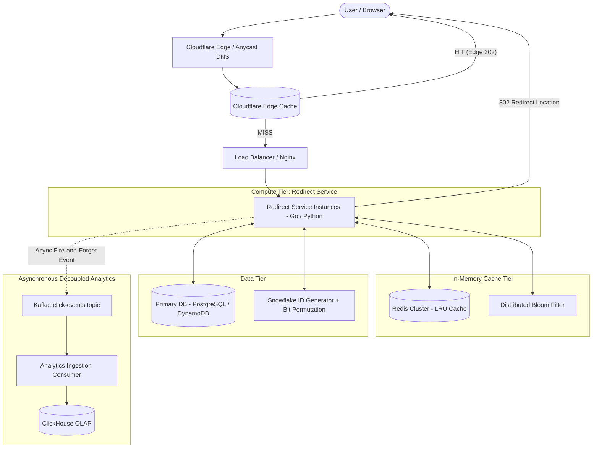

# Distributed URL Shortener (TinyURL / Bitly)

[](https://www.python.org/)
[](https://golang.org/)
[](https://www.docker.com/)
[](https://opensource.org/licenses/MIT)

Part of the [System Design Roadmap](https://github.com/asheeshsahu7300/system-design). This branch contains the production-oriented, end-to-end implementation of a distributed URL Shortener capable of handling billions of redirects with sub-10ms internal lookup latency.

---

## Technical Specifications

- [High-Level Design (HLD)](docs/HLD.md) - Capacity planning, global edge CDN, DB sharding, failure modes.
- [Low-Level Design (LLD)](docs/LLD.md) - UML domain class diagrams, sequence flows, SingleFlight stampede guard, SQL/DynamoDB schema.
- [System Design RFC Document](docs/SYSTEM_DESIGN_RFC.md) - Production RFC, SLOs/SLIs, security threat modeling, disaster recovery runbooks.

---

## 1. Requirements

### Functional Requirements
1. **Shorten URL**: Given a destination URL (up to 2,048 chars), generate a unique short alias (e.g. `https://sho.rt/7bX9qZ`).
2. **Redirection**: Accessing the short link resolves and redirects the client to the destination with sub-10ms lookup latency.
3. **Custom Aliases (Optional)**: Support custom vanity slugs (e.g. `sho.rt/my-portfolio`).
4. **Link Expiry (TTL)**: Optional expiration (default: 2 years).
5. **Analytics**: Asynchronously capture click counts, referrers, and timestamps.

### Non-Functional Requirements
1. **High Availability**: 99.99% uptime for the redirection critical path.
2. **Low Latency**: **Internal service lookup P99 < 10ms** (server-side Redis/app resolution time, excluding client-to-edge network transit RTT).
3. **Read Heavy**: Ratio of reads (redirects) to writes (creations) is **100 : 1**.
4. **Collision Free**: Short codes are mathematically guaranteed unique.
5. **Security**: Short URLs are non-sequential (obfuscated) to prevent crawler enumeration.

---

## 2. Quantitative Sizing & Math

### Traffic Estimation
- **New URLs created (Writes)**: 100 Million / month $\approx$ 3.3 Million / day.
- **Write QPS**: $\frac{3,300,000}{86,400} \approx 38 \text{ writes/sec}$ (Peak: ~100 writes/sec).
- **Read-to-Write Ratio**: $100 : 1$.
- **Read QPS (Redirects)**: $38 \times 100 \approx 3,800 \text{ reads/sec}$ (Peak: ~12,000 reads/sec).

### Storage Estimation (5 Years)
- **Record Size Breakdown**:
  - `short_code`: 7 bytes (VARCHAR)
  - `original_url`: 512 bytes (VARCHAR)
  - `created_at`: 8 bytes (TIMESTAMP)
  - `expires_at`: 8 bytes (TIMESTAMP)
  - `user_id`: 16 bytes (UUID)
  - Overhead & Indexes: ~150 bytes
  - **Total per record**: $\approx 700 \text{ bytes}$.
- **Total Records in 5 Years**: $100 \text{M/mo} \times 12 \times 5 = 6 \text{ Billion records}$.
- **Total Storage**: $6 \times 10^9 \times 700 \text{ bytes} \approx 4.2 \text{ TB}$.

### Memory & Cache Sizing (Active Working Set & 80/20 Rule)

The system receives $\approx 328\text{M redirects/day}$. If 80% of traffic is concentrated on the top 20% hottest URLs:
$$328\text{M} \times 80\% = 262.4\text{M redirects/day to hot URLs}$$

> **The Mathematical Nuance**: Knowing that the hot set receives $262.4\text{M}$ requests does **not** uniquely determine how many *distinct hot URLs* exist.

| Hot Unique URLs | Avg Redirects per Hot URL / Day | Logical RAM (at ~1 KB/entry) |
|---:|---:|---:|
| **100,000** | 2,624 | ~100 MB |
| **500,000** | 525 | ~500 MB |
| **660,000** (Baseline 20% of 3.3M daily writes) | 398 | **~660 MB** |
| **1,000,000** | 262 | ~1.0 GB |
| **10,000,000** (Multi-week campaign pool) | 26 | ~10.0 GB |

#### Production Sizing Recommendation:
> **"Cache approximately 660K hot URLs initially, based on the assumption that 20% of the 3.3M daily active URLs generate 80% of traffic. At ~1 KB per Redis entry (including key, value, and Redis memory overhead), this requires ~660 MB of logical cache capacity. With replication, jemalloc fragmentation, and operational headroom, provision approximately 2-3 GB. In production, the hot-set size should be determined from actual access-frequency data rather than assuming all newly created URLs are active."**

---

## 3. Architecture



---

## 4. Key Design Decisions

### A. Namespace Capacity (7 Characters)
- Base62 characters: `[0-9, a-z, A-Z]` ($62$ characters).
- Total Combinations:
  $$62^7 = 3,521,614,606,208 \approx 3.52 \text{ Trillion}$$
- At 100M new URLs created per month:
  $$\frac{3.52 \times 10^{12}}{100 \times 10^6} = 35,216 \text{ months} \approx 2,935 \text{ years}$$

### B. Slug Generation: Snowflake + Bit Permutation vs KGS
- **Adopted Pattern**:
  $$\text{Twitter Snowflake (64-bit ID)} \longrightarrow \text{Bit Permutation / Feistel Obfuscation} \longrightarrow \text{Base62}$$
- **Guaranteed Uniqueness**: Snowflake IDs are inherently collision-free across distributed nodes.
- **Zero Collision Checks**: No database lookups needed during slug generation.
- **Non-Sequential & Secure**: Feistel cipher scatters sequential IDs into non-contiguous numbers, preventing enumeration attacks.
- **No Inventory Overhead**: Zero pre-generated key storage required.

### C. Redirection Status Code: 302/307 vs 301
- **HTTP 301**: Initial click recorded, but subsequent visits are cached by browsers/CDNs and bypass servers, undercounting analytics.
- **HTTP 302/307 (Chosen)**: Retains full control to record every click, inspect user-agent/referrer, and revoke compromised links instantly.

### D. Critical Path vs Asynchronous Decoupling
- **Critical Path**: Client -> Edge Cache -> Redis -> DB (Resolve `short_code` -> `original_url` and return 302).
- **Asynchronous Path**: Background non-blocking push to Kafka/Buffer for analytics processing in ClickHouse.
- Redirections continue functioning with zero degradation even during Kafka or ClickHouse outages.

---

## 5. Repository Structure (This Branch)

```text
.
├── README.md                 # System overview and quickstart
├── .gitignore                # Clean build artifact ignore rules
├── docs/
│   ├── HLD.md                # High-Level Design specification
│   ├── LLD.md                # Low-Level Design specification
│   └── SYSTEM_DESIGN_RFC.md  # Production RFC and SLOs
├── backend-python/           # Asynchronous FastAPI service (Base62, Redis, Analytics)
├── backend-go/               # High-throughput Go net/http service (Goroutine safe)
├── frontend/                 # Dark glassmorphism dashboard (QR generator, live metrics)
└── deployment/
    ├── docker-compose.yml    # Complete stack (Python, Go, Redis, Nginx)
    ├── nginx.conf            # Reverse proxy configuration
    └── k8s/                  # Kubernetes Deployment and Service manifests
```

---

## 6. Quick Start

### Python Service (FastAPI)
```bash
cd backend-python
pip install -r requirements.txt
python -m uvicorn app.main:app --reload --port 8000
```
Interactive Swagger Documentation: `http://localhost:8000/docs`

### Go Service
```bash
cd backend-go
go run main.go base62.go
```
Service runs on port `8080`.

### Full Stack Deployment (Docker Compose)
```bash
cd deployment
docker compose up --build
```
This boots the Python API (`:8000`), Go API (`:8080`), Redis Cache (`:6379`), and Nginx Frontend (`:3000`).

---

## Branch Navigation

- [Back to Main Repository Roadmap](https://github.com/asheeshsahu7300/system-design)
