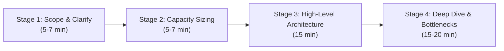

# System Design: From Low-Level Design to Hyperscale Architecture

[](https://opensource.org/licenses/MIT)
[](https://www.python.org/)
[](https://golang.org/)
[](https://www.docker.com/)

A structured engineering repository covering Object-Oriented Low-Level Design (LLD), High-Level Design (HLD), and distributed system architectures.

Each module is constructed end-to-end:
- Architecture and Trade-offs: Quantitative sizing, sequence diagrams, failure recovery.
- Python Implementation: Asynchronous microservices and clean object-oriented domain models.
- Go Implementation: Concurrent, goroutine-safe HTTP microservices.
- User Interface: Dashboards, analytics viewers, and interaction layers.
- Production Deployment: Containerization (Docker Compose), reverse proxy configs, and Kubernetes manifests.

---

## System Catalog & Dedicated Branches

Each system is developed in dedicated branches for isolated modular study and code review:

| Index | System Scope | Design Scope | Target Branch | Python | Go | UI | Deploy | Status |
|---|---|---|---|:---:|:---:|:---:|:---:|:---:|
| **01** | [URL Shortener](systems/01-url-shortener/) | HLD + LLD | [`url-shortner`](https://github.com/asheeshsahu7300/system-design/tree/url-shortner) | Yes | Yes | Yes | Yes | Completed |
| **02** | [Parking Lot System](systems/02-parking-lot/) | LLD / OOD | [`parking-lot`](https://github.com/asheeshsahu7300/system-design/tree/parking-lot) | Yes | Yes | N/A | N/A | Completed |
| **03** | Distributed Rate Limiter | HLD + LLD | [`rate-limiter`](https://github.com/asheeshsahu7300/system-design/tree/rate-limiter) | Planned | Planned | Planned | Planned | Planned |
| **04** | Notification Engine | HLD | [`notification-system`](https://github.com/asheeshsahu7300/system-design/tree/notification-system) | Planned | Planned | Planned | Planned | Planned |
| **05** | Real-Time Chat (WhatsApp/Slack) | HLD + LLD | [`chat-system`](https://github.com/asheeshsahu7300/system-design/tree/chat-system) | Planned | Planned | Planned | Planned | Planned |
| **06** | [Video Streaming (YouTube/Hotstar)](systems/06-youtube-hotstar-streaming/) | Hyperscale HLD | [`video-streaming`](https://github.com/asheeshsahu7300/system-design/tree/video-streaming) | Spec | Spec | Spec | Spec | Spec Ready |
| **07** | [Ride Hailing (Uber/Rapido)](systems/07-uber-rapido-ride-matching/) | Hyperscale HLD | [`ride-hailing`](https://github.com/asheeshsahu7300/system-design/tree/ride-hailing) | Spec | Spec | Spec | Spec | Spec Ready |

---

## Learning Phases & Branch Mapping

### Phase 1: Object-Oriented & Low-Level Design (LLD)
Focus: Design patterns, concurrency controls, clean domain modeling, thread safety.
- Parking Lot System: [`branch: parking-lot`](https://github.com/asheeshsahu7300/system-design/tree/parking-lot)
- In-Memory Key-Value Store with TTL & LRU: [`branch: lru-cache`](https://github.com/asheeshsahu7300/system-design/tree/lru-cache)
- Movie Ticket Booking (Concurrency & Seat Locks): [`branch: ticket-booking`](https://github.com/asheeshsahu7300/system-design/tree/ticket-booking)

### Phase 2: Foundational Microservices & Tier-1 Architectures
Focus: Mathematical capacity sizing, hashing algorithms, cache-aside patterns, data sharding.
- URL Shortener (TinyURL/Bitly): [`branch: url-shortner`](https://github.com/asheeshsahu7300/system-design/tree/url-shortner)
- Distributed Rate Limiter (Token Bucket & Sliding Window): [`branch: rate-limiter`](https://github.com/asheeshsahu7300/system-design/tree/rate-limiter)
- Distributed Unique ID Generator (Snowflake Engine): [`branch: snowflake-id`](https://github.com/asheeshsahu7300/system-design/tree/snowflake-id)

### Phase 3: Real-Time & Event-Driven Systems
Focus: WebSockets, stateful connection pools, message brokers, streaming storage.
- Real-Time Chat Service (WhatsApp/Slack): [`branch: chat-system`](https://github.com/asheeshsahu7300/system-design/tree/chat-system)
- Multi-Channel Notification Platform: [`branch: notification-system`](https://github.com/asheeshsahu7300/system-design/tree/notification-system)

### Phase 4: Hyperscale & Domain-Specific Heavyweights
Focus: Geospatial H3 indexing, adaptive bitrate chunking (HLS/DASH), multi-CDN distribution.
- Video Streaming Platform (YouTube / Hotstar): [`branch: video-streaming`](https://github.com/asheeshsahu7300/system-design/tree/video-streaming)
- Ride Hailing & Dispatch Engine (Uber / Rapido): [`branch: ride-hailing`](https://github.com/asheeshsahu7300/system-design/tree/ride-hailing)

---

## Weekly Roadmap Schedule

| Timeline | Milestone Focus | Deliverable | Associated Branch |
|---|---|---|---|
| **Week 1** | URL Shortener + Sizing Formulas | Python & Go Services + Glassmorphism UI + Docker | [`url-shortner`](https://github.com/asheeshsahu7300/system-design/tree/url-shortner) |
| **Week 2** | Parking Lot OOD + Concurrency | Thread/Goroutine Safe Spot Allocations + Tests | [`parking-lot`](https://github.com/asheeshsahu7300/system-design/tree/parking-lot) |
| **Week 3** | Distributed Rate Limiter | Token Bucket & Redis Sliding Window Counter | [`rate-limiter`](https://github.com/asheeshsahu7300/system-design/tree/rate-limiter) |
| **Week 4** | Notification Engine & Real-Time Chat | Kafka Event Fanout + WebSockets Cluster | [`chat-system`](https://github.com/asheeshsahu7300/system-design/tree/chat-system) |
| **Week 5** | Video Streaming (YouTube/Hotstar) | Transcoder DAG Pipeline + ABR HLS Segments | [`video-streaming`](https://github.com/asheeshsahu7300/system-design/tree/video-streaming) |
| **Week 6** | Ride Hailing (Uber/Rapido) | Uber H3 Hexagonal Indexing + Dispatch Matching | [`ride-hailing`](https://github.com/asheeshsahu7300/system-design/tree/ride-hailing) |

---

## Interview Framework: 4-Stage Execution



1. **Scope & Functional/Non-Functional Constraints**
   - Establish traffic scale, latency SLOs, and write-to-read ratios.
2. **Quantitative Capacity Estimation**
   - Derive average/peak QPS, 5-year storage, active working set cache RAM, and network bandwidth.
3. **High-Level Architectural Design**
   - Define API contracts, edge termination, compute instances, cache topology, primary storage, and event buses.
4. **Targeted Deep Dives & Resiliency**
   - Address single points of failure (SPOF), partition tolerance, cache stampede mitigation, and concurrency race conditions.

---

## Reference Guides

- [Capacity Estimation Reference](docs/cheat-sheets/capacity-estimation.md)
- [Caching Strategies & Database Selection](docs/cheat-sheets/caching-and-databases.md)
- [System Design Interview Playbook](docs/interview-playbook.md)

---

## Local Setup

### URL Shortener Service

```bash
cd systems/01-url-shortener
```

#### Python Service (FastAPI)
```bash
cd backend-python
pip install -r requirements.txt
python -m uvicorn app.main:app --reload --port 8000
```
API Documentation: `http://localhost:8000/docs`

#### Go Service
```bash
cd backend-go
go run main.go base62.go
```
Service runs on port `8080`.

#### Multi-Container Deployment
```bash
cd deployment
docker compose up --build
```

---

## Git Workflow for Branch Contributions

To work on an isolated system branch:

```bash
# Checkout an existing system branch
git fetch origin
git checkout url-shortner

# Push updates to the branch
git push origin url-shortner
```

---

## License
MIT License.
