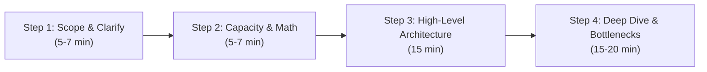

# 🚀 System Design Zero to Hero: From LLD to Hyperscale

[](https://opensource.org/licenses/MIT)
[](https://www.python.org/)
[](https://golang.org/)
[](https://www.docker.com/)
[](#)

A production-grade, hands-on repository designed to master **Low-Level Design (LLD)**, **High-Level Design (HLD)**, and **Distributed Cloud Architecture**.

Every system in this repository is built **End-to-End**:
- 📐 **Architecture & Trade-offs**: Back-of-the-envelope calculations, Mermaid diagrams, DB schema design, failure modes.
- 🐍 **Python Implementation**: Asynchronous, clean OOP / FastAPI microservices.
- 🐹 **Go Implementation**: High-performance, concurrent, goroutine-safe microservices.
- 🎨 **Modern Frontend**: Interactive dashboards, real-time metrics, live streaming or map tracking.
- 🐳 **Production Deployment**: Docker Compose, Nginx reverse proxy, and Kubernetes manifests.

---

## 🗺️ Master Curriculum & System Matrix

| # | System | Type | Key Concepts & Patterns | Python | Go | Frontend | Docker / K8s |
|---|--------|------|-------------------------|:------:|:--:|:--------:|:------------:|
| **01** | [**URL Shortener (TinyURL)**](systems/01-url-shortener/) | HLD + LLD | Base62 encoding, Redis caching, Bloom filters, 301 vs 302, Analytics | ✅ | ✅ | ✅ | ✅ |
| **02** | [**Parking Lot System**](systems/02-parking-lot/) | LLD / OOD | Strategy Pattern, Factory, Concurrency locks, Spot assignment | ✅ | ✅ | 📝 | 📝 |
| **03** | [**Distributed Rate Limiter**](systems/03-rate-limiter/) | HLD + LLD | Token Bucket, Leaky Bucket, Sliding Window Counter, Redis Lua | 🔄 | 🔄 | 🔄 | 🔄 |
| **04** | [**Notification Engine**](systems/04-notification-system/) | HLD | Fanout queues, Idempotency keys, Kafka, Delivery guarantees | 🔄 | 🔄 | 🔄 | 🔄 |
| **05** | [**Real-time Chat (WhatsApp/Slack)**](systems/05-whatsapp-chat/) | HLD + LLD | WebSockets, Presence servers, Cassandra message store, E2EE | 🔄 | 🔄 | 🔄 | 🔄 |
| **06** | [**Video Streaming (YouTube / Hotstar)**](systems/06-youtube-hotstar-streaming/) | Hyperscale HLD | HLS/DASH chunking, Transcoding DAG, CDN Edge caching, Live vs VOD | 🔄 | 🔄 | 🔄 | 🔄 |
| **07** | [**Ride Hailing (Uber / Rapido)**](systems/07-uber-rapido-ride-matching/) | Hyperscale HLD | Geohashing, Uber H3 Hexagons, QuadTree, Surge pricing, Dispatcher | 🔄 | 🔄 | 🔄 | 🔄 |

*Legend: ✅ Implemented & Tested | 🔄 Roadmap / Deep-dive Blueprint | 📝 Documentation & Design*

---

## 🧭 The 4-Step System Design Interview Framework

When facing an HLD or LLD problem in top tech interviews (FAANG / Tier-1):



1. **Step 1: Understand the Problem & Scope**
   - Clarify Functional Requirements (e.g., Shorten URL, redirect, view analytics).
   - Clarify Non-Functional Requirements (High availability, <10ms read latency, consistency vs availability).
2. **Step 2: Capacity Estimation (Back-of-the-Envelope)**
   - Traffic (Read QPS vs Write QPS).
   - Storage (Daily data * 365 * 5 years).
   - Memory/RAM (80-20 rule for cache: 20% of reads served from cache).
   - Bandwidth (Ingress and Egress MB/s).
3. **Step 3: High-Level Architecture Design**
   - API endpoints contract.
   - Core components (API Gateway, App servers, Cache, Database, Message Broker).
   - Data model & storage selection (SQL vs NoSQL).
4. **Step 4: Deep Dive & Failure Modes**
   - Single points of failure (SPOF) & Redundancy.
   - Caching strategies & Cache stampede / Cache penetration.
   - Sharding & Partitioning strategies (Consistent Hashing).
   - Concurrency & Race conditions.

---

## 📚 Essential Cheat Sheets

- 📊 [Capacity Estimation & Math Cheat Sheet](docs/cheat-sheets/capacity-estimation.md)
- 💾 [Caching Strategies & Databases (SQL vs NoSQL)](docs/cheat-sheets/caching-and-databases.md)
- 🎯 [System Design Interview Playbook](docs/interview-playbook.md)

---

## 🛠️ Quick Start: Running the URL Shortener

Navigate to the URL shortener system:

```bash
cd systems/01-url-shortener
```

### Option A: Python Backend (FastAPI)
```bash
cd backend-python
pip install -r requirements.txt
python -m uvicorn app.main:app --reload --port 8000
```
Open interactive Swagger documentation at: `http://localhost:8000/docs`

### Option B: Go Backend
```bash
cd backend-go
go run main.go base62.go
```
Go server starts instantly on port `8080`.

### Option C: Complete Stack via Docker Compose
```bash
docker compose up --build
```
This boots the Python API, Go API, Redis Cache, Nginx Reverse Proxy, and Frontend UI!

---

## 📤 How to Push to Your GitHub

Follow these steps to push this repository to your personal GitHub account:

```bash
# 1. Create a new public repository on GitHub (e.g., 'system-design-zero-to-hero')
# 2. Link your local repo to GitHub
git branch -M main
git remote add origin https://github.com/<YOUR-USERNAME>/system-design-zero-to-hero.git

# 3. Commit all files
git add .
git commit -m "feat: initial commit with roadmap, URL Shortener (Python+Go+UI+Docker), and Parking Lot LLD"

# 4. Push to main
git push -u origin main
```

---

## 📜 License
MIT License. Feel free to use this repository for your interview preparation, open-source portfolio, and production references!
