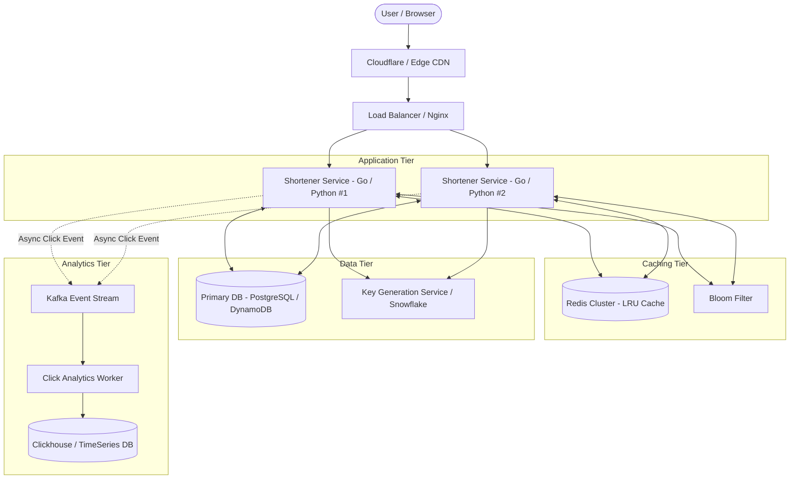

# 🔗 System 01: URL Shortener (TinyURL / Bitly)


> 📖 **Deep-Dive Engineering Specifications**:
> - 📐 [**High-Level Design (HLD) Specification**](docs/HLD.md) — Capacity planning, global edge CDN, DB sharding, failure modes.
> - ⚙️ [**Low-Level Design (LLD) Specification**](docs/LLD.md) — UML domain class diagrams, sequence flows, singleflight, SQL/DynamoDB schema.
> - 📄 [**System Design RFC Document**](docs/SYSTEM_DESIGN_RFC.md) — Production RFC, SLOs/SLIs, security threat modeling, disaster recovery runbooks.

---

## 🎯 1. Requirements

### Functional Requirements
1. **Shorten URL**: Given a long URL (e.g. `https://example.com/very/long/path?param=123`), generate a unique, short alias (e.g. `http://tiny.url/7bX9qZ`).
2. **Redirection**: Accessing the short link redirects the user to the original long URL with minimum latency.
3. **Custom Aliases (Optional)**: Users can supply a custom slug (e.g. `tiny.url/my-portfolio`).
4. **Link Expiry (TTL)**: Short links can optionally expire after a defined duration (default: 2 years).
5. **Analytics**: Track click count, referrers, and access timestamps.

### Non-Functional Requirements
1. **High Availability**: 99.99% uptime (links should never fail to resolve).
2. **Low Latency**: Redirection should execute in **< 10ms**.
3. **Read Heavy**: Ratio of reads (redirects) to writes (creations) is **100 : 1**.
4. **Collision Free**: Short codes must be strictly unique.
5. **Security**: Short URLs should not be easily guessable/sequential to prevent enumeration attacks.

---

## 🧮 2. Back-of-the-Envelope Capacity Estimation

### Traffic Estimation
- **New URLs created (Writes)**: 100 Million / month $\approx$ 3.3 Million / day.
- **Write QPS**: $\frac{3,300,000}{86,400} \approx 38 \text{ writes/sec}$ (Peak: ~100 writes/sec).
- **Read-to-Write Ratio**: $100 : 1$.
- **Read QPS (Redirects)**: $38 \times 100 \approx 3,800 \text{ reads/sec}$ (Peak: ~10,000 reads/sec).

### Storage Estimation (5 Years)
- **Record Size**:
  - `short_code`: 7 bytes (VARCHAR)
  - `original_url`: 512 bytes (VARCHAR)
  - `created_at`: 8 bytes (TIMESTAMP)
  - `expires_at`: 8 bytes (TIMESTAMP)
  - `user_id`: 16 bytes (UUID)
  - Overhead & Indexes: ~150 bytes
  - **Total per record**: $\approx 700 \text{ bytes}$.
- **Total Records in 5 Years**: $100 \text{M/mo} \times 12 \times 5 = 6 \text{ Billion records}$.
- **Total Storage**: $6 \times 10^9 \times 700 \text{ bytes} \approx 4.2 \text{ TB}$ (manageable on a single sharded PostgreSQL/DynamoDB cluster).

### Memory & Cache Estimation (80/20 Rule)
- 20% of the hot URLs account for 80% of daily redirects.
- Daily redirects: $3,800 \times 86,400 \approx 328 \text{ Million reads/day}$.
- Top 20% URLs: $328 \text{M} \times 0.20 \approx 65.6 \text{ Million URLs}$.
- Cache size needed: $65.6 \text{M} \times 700 \text{ bytes} \approx 45.9 \text{ GB}$ of RAM (fits in a standard Redis cluster with LRU eviction).

---

## 🏛️ 3. Architecture Diagram



---

## 🔍 4. Key Design Decisions & Trade-offs

### A. How to Generate Short Codes (Length & Alphabet)
- Using alphanumeric characters: `[a-z, A-Z, 0-9]` = $26 + 26 + 10 = 62$ characters (**Base62**).
- With **7 characters**: $62^7 = 3,521,614,606,208 \approx 3.5 \text{ Trillion}$ unique URLs.
- Even at 100M URLs/month, 7 characters will last **2,900 years**!

### B. MD5 Hash vs Counter + Base62 vs Key Generation Service (KGS)
1. **MD5 / SHA-256 Truncation**:
   - Takes `MD5(long_url)`, extracts first 7 characters.
   - *Problem*: High chance of hash collisions. Resolving collisions requires DB round-trips (`SELECT ...`).
2. **Auto-Incrementing ID + Base62**:
   - Take unique integer ID (e.g. `10,000,001`), convert to Base62 string.
   - *Problem*: Single database auto-increment becomes a bottleneck; sequential IDs leak business volume.
3. **Key Generation Service (KGS) / Pre-generated Keys (Winner)**:
   - A standalone service pre-generates random 7-character Base62 keys in batches and stores them in a "used / unused" table.
   - When a short URL is requested, KGS supplies an already-unique key in $O(1)$ without hashing or lock contention.

### C. 301 Permanent Redirect vs 302 Found (Temporary Redirect)
- **301 Permanent Redirect**:
  - The browser caches the redirect URL locally. Subsequent clicks never touch our servers.
  - *Pro*: Drastically reduces server load.
  - *Con*: **Cannot collect analytics or click metrics** because our server is bypassed.
- **302 Found (Temporary Redirect) (Winner)**:
  - Every click routes through our server first, allowing us to record clicks, IP, referrer, and user-agent before redirecting.
  - *Mitigation*: Cache the mapping in Redis so the 302 response takes $< 5\text{ms}$.

---

## 📂 Implementation Directory Structure

```
01-url-shortener/
├── backend-python/       # Asynchronous FastAPI service (Base62, Redis, Analytics)
├── backend-go/           # High-throughput Go net/http service (Goroutine safe)
├── frontend/             # Modern dashboard (Dark glassmorphism, QR code, live charts)
├── deployment/
│   ├── docker-compose.yml
│   ├── nginx.conf
│   └── k8s/
```
