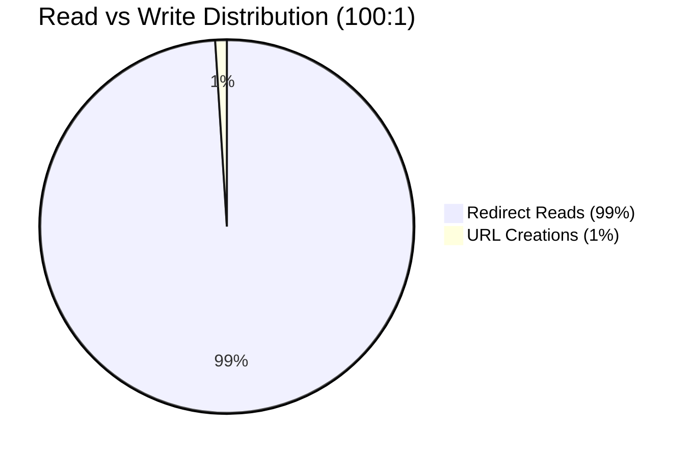
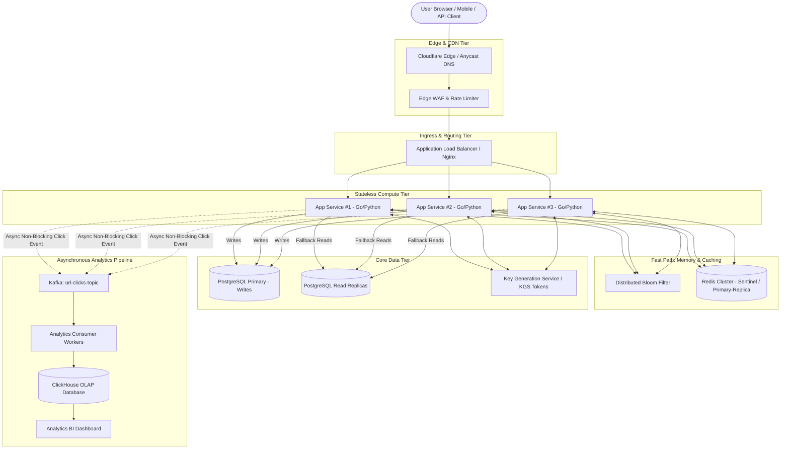
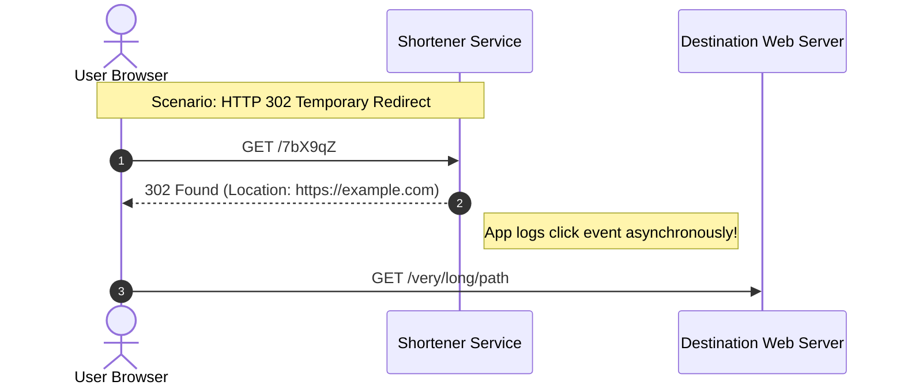

# 🌐 High-Level Design (HLD): Distributed URL Shortener

| Document Version | Status | Target Audience | Primary Focus |
|---|---|---|---|
| **v1.0.0** | Approved / Production-Ready | Senior & Staff System Design | Architecture, Scaling, Distributed Data |

---

## 1. Problem Statement & System Scope

### 1.1 Context
Modern enterprise platforms, social networks, SMS gateways, and marketing campaigns require concise, brandable URLs to optimize character limits, improve user trust, and collect clickstream analytics. A URL shortener maps arbitrary long URLs to short, globally unique alphanumeric strings.

### 1.2 Functional Requirements
1. **Short URL Generation**: Given a destination URL (up to 2,048 characters), generate a short, unique alias (e.g., `https://sho.rt/7bX9qZ`).
2. **Redirection (Core SLA)**: Visiting the short link resolves and redirects the client to the original long URL with sub-10ms latency.
3. **Custom Vanity Slugs**: Users can optionally supply custom aliases (e.g., `sho.rt/summer-sale-2026`).
4. **Time-To-Live (TTL) & Expiration**: Links can optionally expire after a defined duration (default: 2 years; range: 1 hour to 10 years).
5. **Real-Time Click Analytics**: Capture click events (timestamp, referrer, IP, geolocation, user agent) without impacting redirect latency.

### 1.3 Non-Functional Requirements
- **High Availability (HA)**: 99.99% availability ($< 52.6$ minutes downtime/year). The redirection path must never experience downtime.
- **Ultra-Low Latency**: Read redirection P95 $< 8\text{ms}$, P99 $< 15\text{ms}$.
- **Throughput Scalability**: Designed for 100:1 read-to-write ratio at 4,000 read QPS average, bursting up to 25,000 peak QPS.
- **Strict Uniqueness**: Zero collisions permitted across generated short codes.
- **Predictability & Security**: Slugs must be non-sequential to prevent crawler scraping and enumeration attacks.

### 1.4 Non-Goals (Out of Scope for Core Service)
- Built-in URL content hosting or deep web caching.
- Native automated ad injection before redirection.

---

## 2. Capacity Planning & Quantitative Sizing

### 2.1 Traffic Estimation
- **Write Volume**: 100 Million new URLs created / month.
  $$\text{Daily Writes} = \frac{100,000,000}{30} \approx 3,333,333 \text{ writes/day}$$
  $$\text{Average Write QPS} = \frac{3,333,333}{86,400} \approx 39 \text{ QPS} \quad (\text{Peak: } \approx 120 \text{ QPS})$$

- **Read Volume (100:1 Read-to-Write Ratio)**:
  $$\text{Daily Redirects} = 3,333,333 \times 100 \approx 333,333,300 \text{ reads/day}$$
  $$\text{Average Read QPS} = \frac{333,333,300}{86,400} \approx 3,858 \text{ QPS} \quad (\text{Peak: } \approx 12,000 \text{ QPS})$$

### 2.2 Storage Estimation (5 Years)
- **Record Size Breakdown**:
  - `short_code`: 7 bytes (VARCHAR)
  - `original_url`: 512 bytes average (VARCHAR)
  - `created_at`: 8 bytes (BIGINT / TIMESTAMP)
  - `expires_at`: 8 bytes (BIGINT / TIMESTAMP)
  - `user_id`: 16 bytes (UUID)
  - Metadata, Bloom filter index, B-tree overhead: ~150 bytes
  - **Total per record**: $\approx 700 \text{ bytes}$

- **Total Capacity across 5 Years**:
  $$\text{Total Records} = 100 \text{M} \times 12 \times 5 = 6 \text{ Billion URLs}$$
  $$\text{Storage Required} = 6 \times 10^9 \times 700 \text{ bytes} \approx 4.2 \text{ Terabytes}$$
  *(Even over 5 years, 4.2 TB easily fits across sharded relational storage or distributed NoSQL).*

### 2.3 Memory & Cache Sizing (80 / 20 Pareto Rule)
- 20% of generated URLs drive 80% of daily read redirection traffic.
- Daily read count = $333 \text{ Million reads}$.
- 20% of daily unique URLs requested:
  $$333 \text{M} \times 0.20 = 66.6 \text{ Million unique URLs to cache}$$
- **Cache RAM Required**:
  $$\text{RAM} = 66.6 \times 10^6 \times 700 \text{ bytes} \approx 46.6 \text{ GB}$$
  *(A 3-node Redis cluster with 32 GB RAM per node configured with allkeys-lru eviction comfortably handles this).*

### 2.4 Bandwidth Sizing
- **Write Ingress**: $120 \text{ writes/sec} \times 700 \text{ bytes} \approx 84 \text{ KB/s}$ (Negligible).
- **Read Egress (302 redirects)**: $12,000 \text{ reads/sec} \times 500 \text{ bytes response header} \approx 6.0 \text{ MB/s}$ (Easily sustained by standard 1 Gbps NICs).

---

## 3. High-Level Architecture Diagram

---

## 4. Architectural Deep Dives & Trade-Offs

### 4.1 URL Encoding Strategy: Base62 vs Hashing vs KGS

| Strategy | Mechanism | Collision Risk | DB Lookups per Write | Rating |
|---|---|---|---|:---:|
| **MD5 / SHA-256 Truncation** | Take `MD5(long_url)`, take first 7 chars. | High (Birthday Paradox). | Requires repeated `SELECT` checks to resolve collisions. | ❌ Suboptimal |
| **Auto-Increment ID + Base62** | Convert sequential DB `id` to Base62. | Zero collisions. | Single DB write lock; leaks business transaction volume. | ⚠️ Mediocre |
| **Key Generation Service (KGS)** | Dedicated service pre-generates billions of random Base62 keys offline and distributes them in memory buffers. | **Zero collision risk; no hashing runtime overhead.** | **0 DB queries to discover unique key.** | **🏆 Best in Class** |

#### Why Base62?
Characters: `0-9` (10) + `a-z` (26) + `A-Z` (26) = **62 characters**.
With a 7-character string:
$$62^7 = 3,521,614,606,208 \approx 3.52 \text{ Trillion unique URLs}$$
At 100M URLs/month, the 7-character namespace lasts **2,934 years**.

---

### 4.2 Redirection Status Code: 301 vs 302 Found

- **HTTP 301 Moved Permanently**:
  - The browser caches the redirect mapping permanently in local disk cache. Subsequent visits bypass our backend completely.
  - *Advantage*: Zero server load on subsequent clicks.
  - *Fatal Disadvantage*: **Zero analytics or click tracking.** Inability to deactivate malicious or expired links.
- **HTTP 302 Found / 307 Temporary Redirect (Chosen Architecture)**:
  - Browser executes the request through our edge on every click.
  - *Advantage*: Complete auditability, accurate real-time click counts, geo-analytics, and revocation control.
  - *Latency Mitigation*: Response is served in $< 5\text{ms}$ from Redis cache.

---

### 4.3 Database Partitioning & Sharding Strategy
When storage outgrows a single PostgreSQL node:
- **Range-Based Sharding**: (e.g., URLs starting with 'a-c' on Shard 1). Leads to hot-spotting (uneven distribution).
- **Hash-Based Sharding on `short_code` (Chosen)**:
  $$\text{Shard ID} = \text{MurmurHash3}(\text{short\_code}) \pmod N$$
  Ensures uniform distribution across all storage nodes.
- **Consistent Hashing with Virtual Nodes**:
  - Enables adding or removing database nodes dynamically without rebalancing the entire cluster.
  - Virtual nodes prevent hot spots on physical nodes.

---

### 4.4 Mitigating Cache Stampede & Cache Penetration

1. **Cache Penetration (Requests for non-existent short codes)**:
   - Attackers query millions of random codes (e.g., `sho.rt/fake999`), bypassing cache and overwhelming the database.
   - **Solution: Bloom Filter**:
     - Maintain a lightweight in-memory Bloom Filter.
     - If Bloom filter returns `False` $\rightarrow$ Return `404 Not Found` immediately without touching DB or Redis.
2. **Cache Stampede (Hot link expires while thousands of requests arrive)**:
   - Thousands of requests miss cache simultaneously and flood the DB (`thundering herd`).
   - **Solution: SingleFlight / Mutex Locking**:
     - Only 1 worker fetches from DB and populates cache; all other concurrent requests wait on that single promise.

---

## 5. Failure Scenarios & High Availability (HA)

| Failure Scenario | Impact | Architectural Mitigation |
|---|---|---|
| **Redis Node Outage** | Cache misses surge | Redis Cluster with Sentinel auto-failover; fallback read replicas with circuit breakers. |
| **KGS Service Down** | New short URL creations fail | App servers buffer 10,000 pre-allocated keys in local memory; fallback to random generation with DB unique index constraint. |
| **Kafka Cluster Lag** | Click analytics delayed | Analytics are buffered asynchronously; core redirect path is 100% decoupled and unaffected. |
| **Primary DB Crash** | Writes fail temporarily | Automatic promotion of hot standby read replica via Patroni / RDS Multi-AZ within 15 seconds. |
