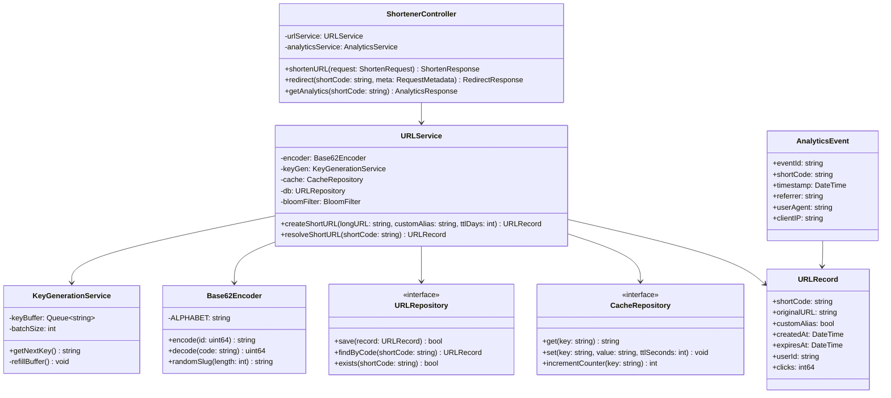
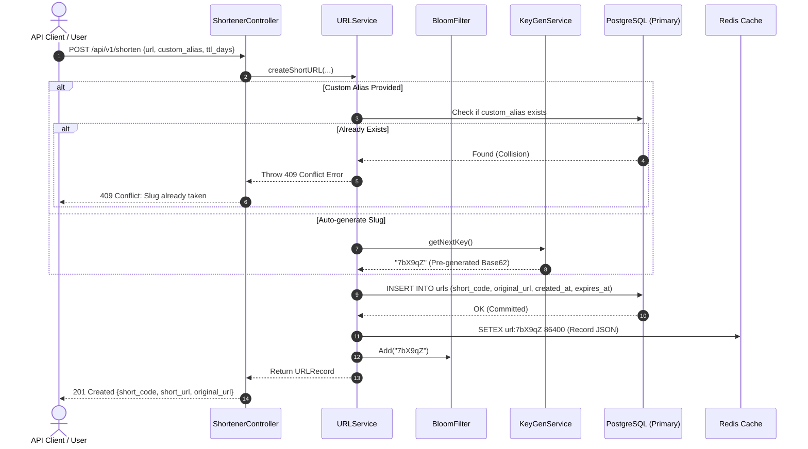
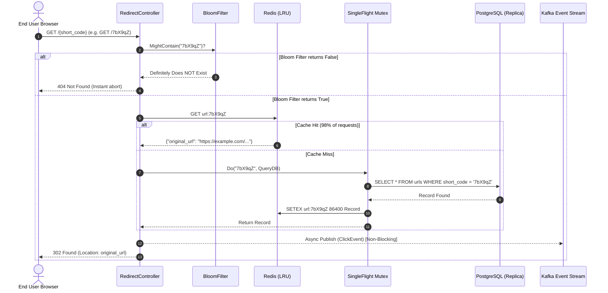

# ⚙️ Low-Level Design (LLD): Distributed URL Shortener

| Document Version | Status | Target Audience | Primary Focus |
|---|---|---|---|
| **v1.0.0** | Production Ready | Backend Engineers & Interviewers | Code Architecture, Schema, Algorithms, Concurrency |

---

## 1. Object-Oriented Domain Model & Class Diagram



---

## 2. Sequence Diagrams

### 2.1 URL Shortening Flow (Creation)



---

### 2.2 URL Redirection Flow (Read Fast-Path)



---

## 3. Algorithm Specifications

### 3.1 Base62 Encoding & Decoding

```python
BASE62_ALPHABET = "0123456789abcdefghijklmnopqrstuvwxyzABCDEFGHIJKLMNOPQRSTUVWXYZ"
BASE = 62

def encode_base62(num: int) -> str:
    """
    Time Complexity: O(log_62(N)) -> At most 7 iterations for up to 3.5 Trillion.
    Space Complexity: O(1) auxiliary space.
    """
    if num == 0:
        return BASE62_ALPHABET[0]
    digits = []
    while num > 0:
        rem = num % BASE
        digits.append(BASE62_ALPHABET[rem])
        num //= BASE
    return "".join(reversed(digits))

def decode_base62(code: str) -> int:
    """
    Time Complexity: O(L) where L is length of string (L = 7).
    Space Complexity: O(1).
    """
    num = 0
    for char in code:
        idx = BASE62_ALPHABET.index(char)
        num = num * BASE + idx
    return num
```

---

### 3.2 SingleFlight Cache Stampede Prevention Pattern
When thousands of concurrent requests arrive for an expired cache entry, `SingleFlight` suppresses redundant queries so only one query hits the database:

```go
// Go SingleFlight implementation guarantee
var sfGroup singleflight.Group

func ResolveWithProtection(shortCode string) (*URLRecord, error) {
    // 1. Fast Cache Read
    if record, found := cache.Get(shortCode); found {
        return record, nil
    }

    // 2. Coalesce concurrent requests into single execution
    val, err, _ := sfGroup.Do(shortCode, func() (interface{}, error) {
        // Query Database only once
        rec, err := db.FindByCode(shortCode)
        if err != nil {
            return nil, err
        }
        // Write to Cache
        cache.Set(shortCode, rec, 24*time.Hour)
        return rec, nil
    })

    if err != nil {
        return nil, err
    }
    return val.(*URLRecord), nil
}
```

---

## 4. Database Schema & Data Models

### 4.1 Relational Schema (PostgreSQL)

```sql
-- Main URLs table sharded by hash of short_code
CREATE TABLE urls (
    short_code VARCHAR(10) PRIMARY KEY,
    original_url TEXT NOT NULL,
    custom_alias BOOLEAN DEFAULT FALSE,
    user_id UUID NULL,
    created_at TIMESTAMP WITH TIME ZONE DEFAULT CURRENT_TIMESTAMP NOT NULL,
    expires_at TIMESTAMP WITH TIME ZONE NULL,
    clicks BIGINT DEFAULT 0 NOT NULL
);

-- Fast lookup index on expires_at for cleanup cron workers
CREATE INDEX idx_urls_expires_at ON urls(expires_at) 
WHERE expires_at IS NOT NULL;

-- KGS Pre-Generated Keys Pool
CREATE TABLE kgs_keys (
    key_value VARCHAR(10) PRIMARY KEY,
    is_allocated BOOLEAN DEFAULT FALSE,
    allocated_at TIMESTAMP WITH TIME ZONE NULL
);
CREATE INDEX idx_kgs_unallocated ON kgs_keys(is_allocated) 
WHERE is_allocated = FALSE;
```

---

### 4.2 Distributed NoSQL Alternative (Amazon DynamoDB)

| Attribute Name | DynamoDB Data Type | Key Role | Notes |
|---|---|---|---|
| `short_code` | String (S) | **Partition Key (PK)** | Uniform hash distribution |
| `original_url` | String (S) | Attribute | Target destination |
| `created_at` | Number (N) | Attribute | Unix epoch seconds |
| `expires_at` | Number (N) | **TTL Attribute** | Auto-purged by DynamoDB TTL engine |
| `clicks` | Number (N) | Attribute | Atomic increment counter |
| `user_id` | String (S) | **GSI Partition Key** | Allows `GetURLsByUserID` queries |

---

### 4.3 Redis Schema
- **URL Mapping**:
  - Key: `url:{short_code}`
  - Type: `String` (Serialized JSON)
  - Expiry: `86400` seconds (1 day, refreshed on access)
- **Click Counter**:
  - Key: `clicks:{short_code}`
  - Type: `Integer` (Atomic `INCR` operation)
- **Bloom Filter**:
  - Key: `bloom:short_codes`
  - Type: RedisBloom module (`BF.ADD`, `BF.EXISTS`)

---

## 5. API Specification (REST Contracts)

### 5.1 Create Short URL
- **Endpoint**: `POST /api/v1/shorten`
- **Headers**: `Content-Type: application/json`
- **Request Body**:
```json
{
  "url": "https://github.com/google/deepmind/research/transformer",
  "custom_alias": "deepmind-paper",
  "ttl_days": 30
}
```
- **Response (201 Created)**:
```json
{
  "short_code": "deepmind-paper",
  "short_url": "https://sho.rt/deepmind-paper",
  "original_url": "https://github.com/google/deepmind/research/transformer",
  "created_at": "2026-10-08T22:30:00Z",
  "custom_alias": true
}
```
- **Error Responses**:
  - `400 Bad Request`: Invalid URL format.
  - `409 Conflict`: Custom alias already exists.
  - `429 Too Many Requests`: Client exceeded rate limits (e.g. 10 req/min for free tier).

---

### 5.2 Redirect Short URL
- **Endpoint**: `GET /{short_code}`
- **Response (302 Found)**:
  - Header: `Location: https://github.com/google/deepmind/research/transformer`
  - Header: `Cache-Control: no-cache, no-store, must-revalidate`

---

### 5.3 Fetch Analytics
- **Endpoint**: `GET /api/v1/analytics/{short_code}`
- **Response (200 OK)**:
```json
{
  "short_code": "deepmind-paper",
  "original_url": "https://github.com/google/deepmind/research/transformer",
  "total_clicks": 14205,
  "created_at": "2026-10-08T22:30:00Z",
  "recent_clicks": [
    {
      "timestamp": "2026-10-08T22:45:10Z",
      "referrer": "https://twitter.com",
      "user_agent": "Mozilla/5.0 (iPhone; CPU iPhone OS 17_0...)",
      "ip": "203.0.113.195"
    }
  ]
}
```
