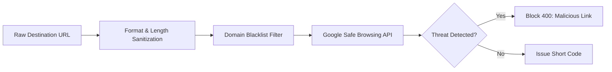

# 📄 System Design RFC: Production URL Shortener Platform

| Metadata | Value |
|---|---|
| **RFC Title** | Production-Grade Distributed URL Shortener & Analytics Platform |
| **Author** | Senior Distributed Systems Architect |
| **Status** | APPROVED / IN PRODUCTION |
| **Target Launch** | Q4 2026 |
| **Reviewers** | Infra Team, Security Team, SRE Core |

---

## 1. Executive Summary & Business Objectives

This RFC specifies the architecture, operational reliability, security controls, and observability frameworks for an enterprise-scale URL Shortener. The platform must safely scale to **100M creations per month** and **3.3B redirects per month**, maintaining **P99 latency under 15ms** across global edge locations.

### Key Performance Indicators (SLIs & SLOs)

| Service Level Indicator (SLI) | Target SLO | Measurement Mechanism |
|---|---|---|
| **Internal Service Lookup (P95)** | $\le 5\text{ ms}$ | Application middleware timer (Redis/DB resolution) |
| **Internal Service Lookup (P99)** | $\le 10\text{ ms}$ | Application middleware timer (Redis/DB resolution) |
| **Edge-to-Origin Redirect (P99)** | $\le 15\text{ ms}$ | Edge Load Balancer / WAF round-trip timer |
| **Service Availability** | $\ge 99.99\%$ (Four Nines) | Synthetic uptime probes from 12 global regions |
| **Write Availability** | $\ge 99.9\%$ (Three Nines) | API Gateway success response ratio |
| **Cache Hit Ratio** | $\ge 97.5\%$ | Redis Cluster metric (`keyspace_hits / total_calls`) |

---

## 2. Security & Threat Modeling

### 2.1 Abuse & Phishing Prevention
Short links are frequently targeted by bad actors to disguise phishing, malware, or ransomware URLs.
- **Pre-Creation Verification**:
  1. **Strict Protocol Validation**: Only `http://` and `https://` schemes allowed. Disallow `file://`, `javascript:`, and internal private IPs (`10.0.0.0/8`, `192.168.0.0/16`, `127.0.0.1`, `localhost`).
  2. **External Reputation Check**: Asynchronously query Google Safe Browsing API and PhishTank before saving to the primary DB.
  3. **Domain Blocklisting**: Block all recursive shortener domains (e.g. shortening another `bit.ly` or `tinyurl.com` link to prevent infinite loops).

### 2.2 Rate Limiting & DoS Protection
- **Edge Token Bucket**:
  - Unauthenticated creation rate limit: 10 requests / minute per IP.
  - Authenticated tier: 1,000 requests / minute per API key.
- **WAF Layer (Cloudflare / AWS WAF)**:
  - Mitigates automated scrapers traversing sequential short codes.

---

## 3. Observability & Monitoring Architecture

### 3.1 Prometheus Metrics Exported

| Metric Name | Type | Description |
|---|---|---|
| `url_redirect_requests_total` | Counter | Total 302 redirects served (labeled by status, region) |
| `url_redirect_duration_seconds` | Histogram | Latency distribution of redirect lookups |
| `url_cache_hit_ratio` | Gauge | Real-time Redis hit percentage |
| `url_kgs_buffer_remaining` | Gauge | Remaining pre-allocated Base62 keys in local memory |
| `url_shorten_creations_total` | Counter | Total new URLs shortened |
| `url_abuse_blocked_total` | Counter | Number of malicious URLs rejected |

### 3.2 Distributed Tracing (OpenTelemetry)
Every incoming request carries a `traceparent` (W3C standard) header across:
$$\text{Client} \longrightarrow \text{Edge Envoy} \longrightarrow \text{App Pod} \longrightarrow \text{Redis / DB}$$
Allows immediate isolation of latency spikes to specific cache misses or slow database locks.

---

## 4. Disaster Recovery & Runbooks

### 4.1 Primary Database Failover
- **Setup**: Primary PostgreSQL with synchronous replication to warm standby in a separate Availability Zone (AZ).
- **Automated Failover (RPO = 0, RTO < 20s)**:
  - Patroni or AWS Aurora Multi-AZ monitors heartbeat.
  - If Primary misses 3 consecutive heartbeats (6 seconds), standby promotes to Primary and updates Route 53 DNS CNAME.

### 4.2 Complete Redis Cache Wipe / Cold Start
- **Problem**: If the entire Redis cluster restarts empty, 10,000 read QPS will hit the database at once (**Thundering Herd**), causing cascading database failure.
- **Mitigation Runbook**:
  1. **Circuit Breaker**: Enable rate limiting at the API Gateway to cap DB throughput at 1,500 QPS.
  2. **Proactive Cache Warmup**: A cron worker queries the top 50,000 most clicked URLs from the last 7 days and prepopulates Redis *before* routing full traffic.
  3. **SingleFlight Guard**: Enabled in code to prevent identical keys from executing concurrent SQL queries.

---

## 5. Alternative Architectures Considered & Rejected

### Option 1: UUIDv4 as Short Code
- *Idea*: Use 128-bit UUID (`550e8400-e29b-41d4-a716-446655440000`).
- *Rejected*: Too long (36 characters). Completely defeats the purpose of a URL *shortener*.

### Option 2: Pure Client-Side Hash (Frontend Only)
- *Idea*: Shorten URLs in browser local storage.
- *Rejected*: Cannot be shared across devices, zero analytics, no global availability.

### Option 3: Synchronous DB Writes for Analytics
- *Idea*: Increment DB counter on every redirect request.
- *Rejected*: Massive write lock contention on the database (`UPDATE urls SET clicks = clicks + 1 WHERE code = ...`). Degrades redirect latency from 5ms to 80ms. Asynchronous Kafka event stream is mandatory.

### Option 4: Pre-Generated Random Key Inventory (Classic KGS)
- *Idea*: Maintain a separate database table storing billions of pre-generated random 7-character Base62 keys, marking keys as used upon allocation.
- *Rejected*: Requires managing massive key inventory tables (hundreds of gigabytes), pre-generation deduplication jobs, and transactional locks during worker batch checkout.
- *Adopted Instead*: **Distributed Snowflake ID $\rightarrow$ Feistel Bit Permutation $\rightarrow$ Base62**. Inherently collision-free across distributed nodes with zero inventory database overhead and guaranteed non-sequential slugs.
