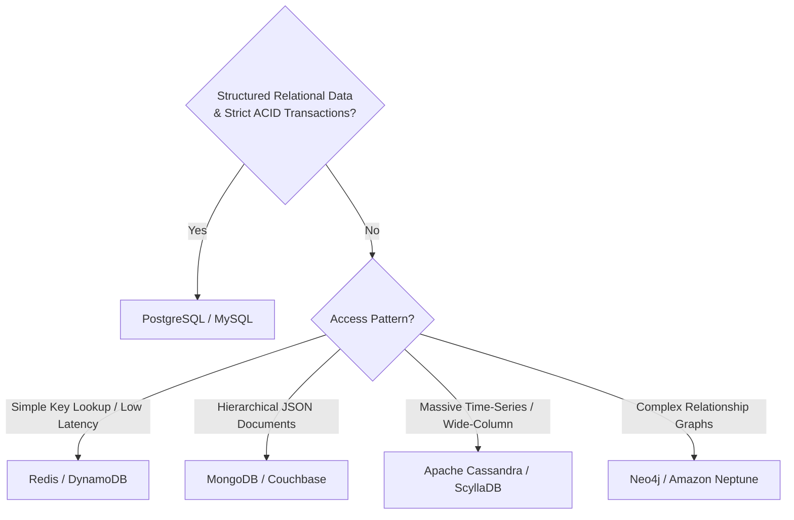

# Caching Strategies & Database Selection Cheat Sheet

---

## 1. Caching Strategies

| Pattern | Description | Pros | Cons | Best Used For |
|---------|-------------|------|------|---------------|
| **Cache Aside (Lazy Loading)** | Application checks cache first. On miss, reads from DB and populates cache. | Only requested data is cached. Cache failures don't halt writes. | Cache miss penalty (3 trips). Stale data if DB updated directly. | General read-heavy systems (User profiles, URL shortener). |
| **Write Through** | Data is written to cache and DB simultaneously in one operation. | Cache is always consistent with DB. Fast subsequent reads. | High write latency (writes must succeed in both). | Financial ledgers, real-time counters. |
| **Write Back (Write Behind)** | App writes to cache immediately; cache asynchronously writes to DB in batches. | High write throughput. Absorbs write bursts. | Risk of data loss if cache crashes before syncing to DB. | Real-time analytics, IoT sensor telemetry. |
| **Refresh Ahead** | Cache automatically reloads frequently accessed keys before expiry. | Near zero cache miss latency for hot keys. | Complex to predict access patterns accurately. | Flash sale item details, breaking news headlines. |

---

## 2. SQL vs NoSQL Decision Matrix

### When to Pick SQL (PostgreSQL, MySQL)
- Need ACID compliance (e-commerce checkout, financial transactions).
- Structured schema with relational foreign keys.
- Complex multi-table joins.

### When to Pick NoSQL
- **Key-Value (Redis, DynamoDB)**: Low-latency lookups (<5ms), session storage, URL shortener mapping, caching.
- **Wide-Column (Cassandra, ScyllaDB)**: High write throughput, millions of events/sec, append-heavy chat history (WhatsApp, Discord), IoT metrics.
- **Document (MongoDB)**: Semi-structured catalogs, flexible schema, fast prototyping.
- **Search Engine (Elasticsearch, OpenSearch)**: Full-text search, fuzzy matching, log analytics.
