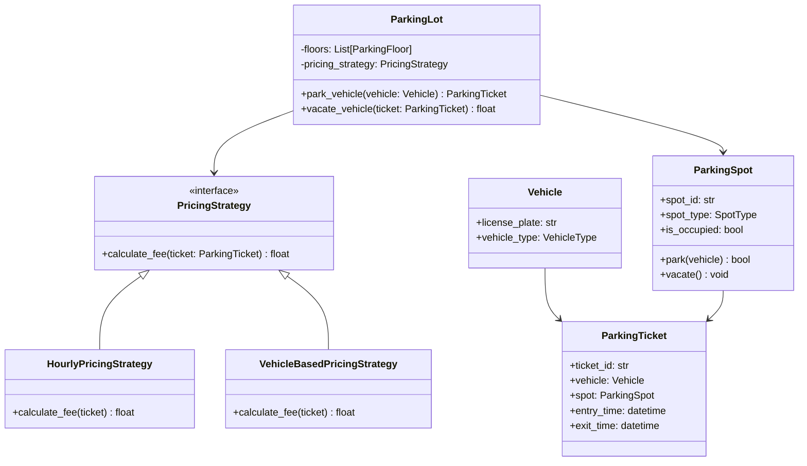

# 🅿️ System 02: Parking Lot System (Low-Level Design / OOD)

A comprehensive Low-Level Object-Oriented Design (LLD/OOD) implementation of a multi-floor parking lot with thread-safe spot allocation, dynamic fee strategies, and concurrency controls.

---

## 🎯 1. Requirements

### Functional Requirements
1. **Multi-Floor Capacity**: The parking lot contains multiple floors, each with designated spots.
2. **Vehicle Types**: Supports **Motorcycles**, **Cars**, and **Buses/Trucks**.
3. **Spot Types**:
   - Compact Spot (Motorcycles & small cars)
   - Regular Spot (Cars & Motorcycles)
   - Large Spot (Buses/Trucks, Cars, Motorcycles)
4. **Ticket Issuance**: When a vehicle enters, if a suitable spot is available, the system assigns the nearest available spot and issues a timestamped ticket.
5. **Fee Calculation**: Upon exit, calculate parking fees based on customizable pricing strategies (Hourly, Flat, Vehicle-specific).
6. **Concurrency Safety**: Multiple vehicles arriving at simultaneous entry gates cannot be assigned the same parking spot (Race condition prevention).

---

## 📐 2. Class Diagram & Architecture

---

## 💡 3. Applied Design Patterns

1. **Strategy Pattern** (`PricingStrategy`):
   - Separates fee computation from the core parking lot engine.
   - Allows changing tariffs (e.g., peak hours, airport rates, flat fee) without modifying vehicle or spot classes.
2. **Factory Pattern** (`VehicleFactory`, `SpotFactory`):
   - Decouples client code from concrete implementations.
3. **Thread Safety & Concurrency Control**:
   - **Python**: Uses `threading.RLock()` to ensure atomic spot assignment.
   - **Go**: Uses `sync.RWMutex` to allow concurrent status reads while serializing ticket generation and spot locking.
