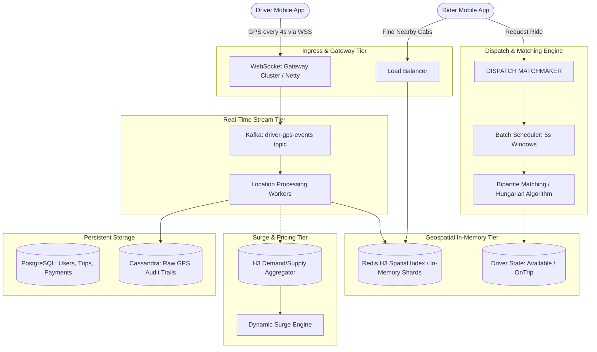

# System 07: Real-Time Ride Hailing & Dispatch (Uber / Rapido / Lyft)

An end-to-end architectural deep dive into geospatial indexing, real-time vehicle tracking, high-frequency dispatch algorithms, and dynamic surge pricing.

---

## 1. Requirements

### Functional Requirements
1. **Real-Time Driver Location Ingestion**: Drivers stream their live GPS coordinates $(lat, lng, heading, speed)$ every 3 to 4 seconds.
2. **Nearby Driver Discovery**: Riders open their app and view real-time cars/bikes moving on their map within a 3–5 km radius.
3. **Ride Request & Matching**: When a rider clicks "Book Ride", find the optimal available driver within seconds.
4. **Dynamic Surge Pricing**: Automatically adjust fare multipliers in localized zones when rider demand exceeds driver supply.
5. **Turn-by-Turn ETA & Tracking**: Continuous live trip tracking and ETA updates for rider and driver.

### Non-Functional Requirements
1. **Ultra-Low Latency**: Location updates must be reflected within **< 1 second**.
2. **High Write Throughput**: Ingest 250,000+ driver GPS pings per second with zero data loss.
3. **Strong Availability**: 99.99% uptime. A crash in one city zone must not impact other regions.
4. **Fault Tolerance**: Network disconnects (underpasses, cellular dead zones) must gracefully reconnect without duplicating ride bookings.

---

## 2. Back-of-the-Envelope Capacity Estimation

### Location Ingestion Throughput
- **Active Drivers globally**: 1,000,000 drivers online concurrently.
- **Update Frequency**: Every 4 seconds.
- **Ingestion QPS**: $\frac{1,000,000}{4} = 250,000 \text{ GPS pings/second}$ (Peak: ~500,000 pings/sec).
- **Ping Payload**:
  - `driver_id`: 16 bytes (UUID)
  - `latitude`, `longitude`: 16 bytes (Float64)
  - `timestamp`: 8 bytes
  - `heading`, `speed`: 8 bytes
  - Total payload: ~100 bytes $\times 250,000 \approx 25 \text{ MB/s}$ ingress (Network bandwidth is modest; write IOPS in DB is the real challenge!).

### Read QPS (Riders Viewing Nearby Cabs)
- **Active Riders viewing map**: 5,000,000 concurrent riders.
- **Map poll interval**: Every 5 seconds.
- **Read QPS**: $\frac{5,000,000}{5} = 1,000,000 \text{ reads/second}$.

---

## 3. Architecture Diagram



---

## 4. Geospatial Indexing: Why Uber Built H3

### The Dilemma: Why Traditional SQL Fails
- A simple SQL query:
  ```sql
  SELECT * FROM drivers 
  WHERE ST_DWithin(location, ST_MakePoint(lat, lng), 5000);
  ```
  At 250,000 writes/second, traditional R-Tree or PostGIS spatial indexes experience severe disk lock contention and index rebalancing overhead.

### Comparison of Spatial Indexing Technologies

| Technology | Shape | Strengths | Weaknesses |
|---|---|---|---|
| **Geohash** | Rectangles | Easy string prefix matching (`dr5ru...`). | Boundary discontinuity; diagonal distortion near poles. |
| **Google S2** | Squares on Sphere | Hilbert space-filling curve; excellent coordinate projections. | Square cell neighbor distances vary by $\sqrt{2} \approx 1.414$ between edges and diagonals. |
| **Uber H3 (Winner)** | **Hexagons** | **Equal distance to all 6 neighbors!** Perfect for radial radius searches & smooth continuous heatmaps. | Complex math for cell boundary subdivisions (aperture 7). |

---

## 5. Ride Matching: Greedy vs Batch Optimization

1. **Greedy Matching (Naive)**:
   - Assign the closest driver immediately when a request arrives.
   - *Failure Mode*: If Driver A is 100m away from Rider 1, but Rider 2 is 50m away from Driver A, greedy matching causes sub-optimal wait times across the city.
2. **Batch Window Matching (Uber / Rapido Way)**:
   - Accumulate ride requests and driver locations into **2 to 5 second micro-batches**.
   - Model the matching as a **Weighted Bipartite Matching Problem**:
     $$\min \sum \text{ETA}(Rider_i, Driver_j)$$
   - Solved in milliseconds using the **Hungarian Algorithm** or **Kuhn-Munkres Algorithm**, maximizing global pickup efficiency!
